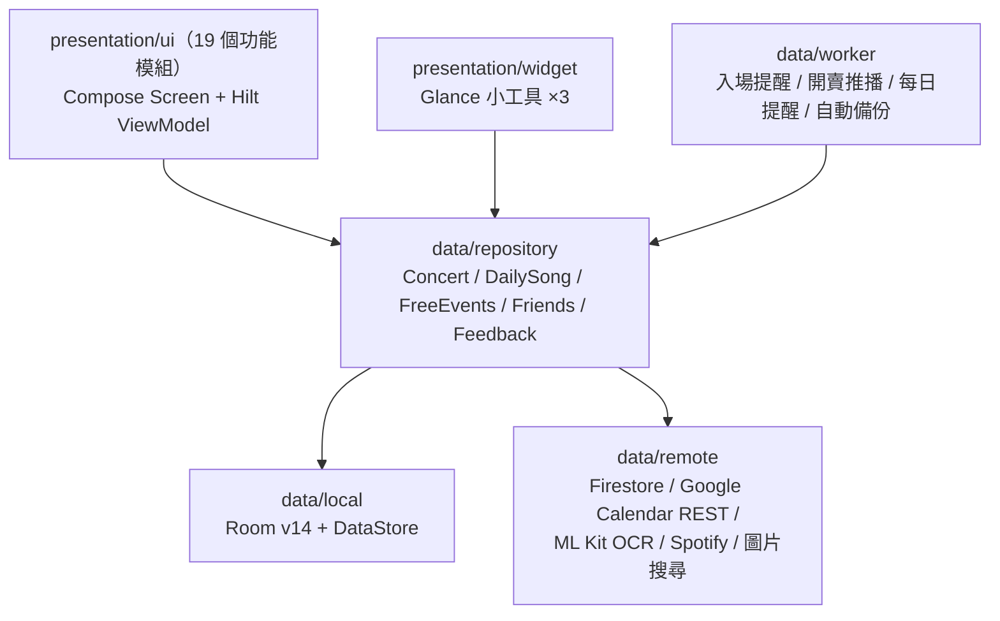

# Bandary 聽團曆 — 作品集

> 本文件是對外展示用的完整專案介紹（履歷 / 作品集用途）。
> **維護方式見 [PORTFOLIO_AI_GUIDE.md](PORTFOLIO_AI_GUIDE.md)**——程式碼仍在迭代中，任何 AI 模型（或人）都應依該指南同步更新本文件。

---

## 專案摘要

| 項目 | 內容 |
| --- | --- |
| 專案名稱 | Bandary 聽團曆 |
| 一句話 | 台灣現場音樂愛好者的演出檔案 App——記一次，未來的幫你倒數提醒，過去的自動變成統計、年度回顧與可分享的票根 |
| 平台 | Android（Kotlin + Jetpack Compose，minSdk 26 / compileSdk 34） |
| 角色 | 獨立開發（產品定位、UI/UX、架構、前後端整合、文案規範皆一人完成，並以 AI 結對開發加速迭代） |
| 期間 | 2026-05 至今（持續迭代中，現版本 1.1.7.x） |
| 規模 | 77 個 Kotlin 檔案、約 2.3 萬行程式碼、19 個 UI 模組、Room DB schema 已演進至 v14（含正式 Migration） |
| 狀態 | 功能完成度高、可日常使用；準備上架 Google Play |

**技術標籤**：`Kotlin` `Jetpack Compose` `Hilt` `Room (KSP2)` `DataStore` `WorkManager` `Glance Widget` `Firebase Auth / Firestore` `Google Calendar API` `ML Kit OCR` `Coil` `OkHttp` `Material 3`

---

## 一、產品定位：解決什麼問題

台灣的「現場咖」（聽團仔＋演唱會追星族）一年看很多場演出，但他們的紀錄散落各處：日期埋在聊天紀錄、花費沒人算過、實體票根塞在抽屜。既有工具（Google 日曆、備忘錄）的共同缺陷是**記了不會累積**——過了就過了，不會變成「我今年看了 23 場、花了 4 萬 8、最常去 Legacy」。

Bandary 的差異化就一句話：**記一次，前後都有用。**

- **往前看（工具價值，負責留存）**：倒數、開賣提醒、入場提醒、好友共享日曆、桌面小工具
- **往後看（情感價值，負責 Aha 與傳播）**：統計、年度回顧（Wrapped）、票根海報分享

情感面是鉤子——「幫你管理行程」任何日曆都能說，「把你的現場人生變成一份會累積的檔案」只有 Bandary 能說。

---

## 二、功能總覽

### 核心紀錄
- **我的演唱會**：卡片 / 列表 / 瀑布流三種顯示、月份 sticky 分組、倒數計時、評分、購票連結 / 取票序號 / 開賣時間、多圖＋場位圖、多表演者（計入統計）、自訂卡片底色、內建底圖自動分配
- **批量匯入**：CSV 檔或直接貼上清單（一行一場），欄位容錯解析、可勾選預覽、重複偵測——老使用者可一次補回整個看團史
- **Google 日曆匯入**：選時間範圍（含過往）、勾選預覽、雙向同步（新增演唱會自動推回日曆）
- **每日選歌**：Google 日曆式介面、每天多首、rank 排序，累積成個人的選歌統計

### 統計與分享
- **演出統計**：期間篩選、場館 / 縣市 / 售票平台排行（每列可點入看符合場次）、藝人花費、藝人明細頁
- **統一海報管線（PosterRenderer）**：票根分享與統計 Wrapped 共用同一套渲染——5 款排版樣式（格線誌 / 大字出血 / 直排 / 中英對照 / 簡潔）× 主題色系 × 9:16 匯出，所見即所得即時預覽
- **桌面小工具（Glance）**：倒數、月曆、開賣提醒三款

### 社群與雲端
- **免費活動**：全體使用者共同維護的雲端清單（清單 / 月曆雙檢視），投稿審核制（一般使用者投稿 → 管理員核准 / 退回），一鍵「我要參加」收藏成自己的場次
- **好友**：發布自己即將到來的演出、依 email 加好友、互看共享日曆
- **雲端備份**：Firebase Auth（Google 登入）+ Firestore 跨裝置備份還原——但**本機優先，不登入也能完整使用**

### 其他
- **音樂祭模式**：上傳節目表圖 → ML Kit OCR 半自動辨識 → 點選看過的團，計入統計
- **通知**：開賣提醒 / 入場提醒 / 每日紀錄提醒（WorkManager）
- **首次啟動引導**：價值主張 → 意圖式個人化（想先做哪件事）→ 透明的權限請求 → 依意圖導向第一個動作
- **管理後台**：免費活動審核、使用統計、App 內意見回饋（投稿＋管理員檢視）
- **個人化**：6 色主題＋自訂調色盤、深淺色、自訂起始分頁、自訂購票平台

---

## 三、系統架構

單一 module、分層清晰的 MVVM + Repository 架構：

- **UI 層**：純 Compose（Material 3），19 個功能模組各自獨立（shows / calendar / stats / share / free / friends / festival / importcal / importbulk / onboarding / admin / feedback / settings…），共用元件抽在 `components`
- **資料層**：Room 為單一真相來源（local-first），Firestore 只負責雲端功能與備份；DataStore 管設定
- **背景工作**：WorkManager（自訂 `Configuration.Provider` 初始化）驅動三類通知與自動備份
- **導覽**：單 NavHost + sealed `Screen` 路由，通知深連結與底部分頁歷史返回

---

## 四、工程亮點與技術決策

以下每一項都是「遇到什麼限制 → 做了什麼取捨 → 得到什麼」：

**1. Local-first 架構，登入是加值不是門檻**
所有核心功能（紀錄、統計、分享）完全離線可用，Room 是唯一真相來源；Firebase 只在使用者主動碰雲端功能（免費活動、好友、備份）時才需要登入。權限與帳號採「階梯式」：onboarding 只問通知權限，Google 登入與日曆授權都延後到使用情境中才請求，並明確告知拒絕後果（無死路）。

**2. 免費活動圖片：Base64 存進 Firestore，省掉整個付費方案**
Firebase Storage 需要付費方案，但活動圖是剛需。解法：本機縮圖＋JPEG 壓縮後以 Base64 直接存進 Firestore 文件（單張約 100KB，遠低於 1MiB 文件上限）。零額外成本、零新增依賴，換來的限制（單張、解析度）對「活動宣傳圖」場景完全可接受。

**3. 統一海報渲染管線（PosterRenderer）**
票根分享與統計 Wrapped 原本是兩套獨立的繪製邏輯。重構成單一 PosterRenderer 後，5 款排版 × 主題色 × 底圖來源的所有組合兩邊共用，預覽即輸出（9:16）；不同排版依可用空間自動決定顯示多少資訊區塊（時間 / 座位 / 平台 / 歌單）。新增一款排版，兩個功能同時受益。

**4. 音樂祭 OCR 半自動流程**
音樂祭一天幾十團，手動輸入不現實；全自動辨識節目表又不可靠。取捨成半自動：ML Kit OCR 掃節目表圖 → 使用者點選自己看過的團 → 計入統計。機器做苦工，人做判斷。

**5. KSP2 工具鏈遷移與資料庫演進紀律**
Kotlin 2.2 下 KAPT 讀不了新 metadata，全面遷移到 KSP2（Hilt + Room），並踩過 Room 2.6.1 的 `unexpected jvm signature V` 相容性坑（升 2.7.x 解決）。DB schema 演進至 v14，堅持寫正式 SQL Migration（`ALTER TABLE …`）而非破壞性重建，保護使用者本機資料。

**6. 誠實模式：不做不可靠的功能**
「開賣時間自動抓取」在手機端爬售票網站 SPA 不可靠，與其做一個常常錯的功能，選擇誠實模式：手動輸入＋確實的提醒，並把「自架伺服器爬取」列為未來項目。功能可以少，不能騙。

---

## 五、產品與設計思維

- **文案語氣規範（docs/COPY_GUIDE.md）**：全站面向使用者的字串統一為克制、成熟的雜誌編輯語氣，建立用字對照表（「搶票」→「開賣」、「打卡」→「紀錄」…），並規範 placeholder 與通知文案——把 tone of voice 當成設計系統的一部分管理
- **視覺方向**：雜誌 / 編輯式排版、襯線標題、莫蘭迪色系海報範本、方框元素、黑色主題；卡片底色可從票根圖自動取色
- **意圖式 Onboarding**：不問「你最常用哪個頁面」（新使用者答不出來），改問「你想先做哪件事」——三個意圖各自導向最短的 Aha 路徑（新增第一場 / 批量匯入補回看團史 / 逛免費活動），順便完成起始分頁個人化
- **透明的商業模式**：核心功能全部免費且開宗明義講清楚；Pro（海報下載到相簿等小加值）只在使用情境中出現，不在 onboarding 設 paywall

---

## 六、開發流程與工程紀律

- **README 作為單一真相來源**：每次功能告一段落即在 README 追加日期式更新記錄（修正 / 新增分區），章節同步——整個專案歷程可完整回溯
- **規格書驅動的批次開發**：改版總規格書＋ROADMAP 拆成 A–M 批次（錯誤修正 / UX / 主題 / 分享管線 / 統計強化 / 好友 v2…），每批含開工前決策點與架構影響分析
- **已知雷區文件化**：KSP2 / Room 版本、WorkManager 初始化、package 綁定 Firebase 等踩坑經驗全部寫進 README「修改前必讀」，讓任何協作者（包含 AI）不重複踩坑
- **AI 結對開發**：以 AI 輔助實作與重構，人負責產品決策、驗收與真機測試；文件（README / 規格書 / 文案規範 / 本作品集）都設計成 AI 可讀可維護的形式

---

## 七、專案數據

| 指標 | 數值（2026-07-14） |
| --- | --- |
| Kotlin 檔案 | 77 |
| 程式碼行數 | 約 22,700 行 |
| UI 功能模組 | 19 個 |
| Room schema 版本 | v14（含正式 Migration） |
| 桌面小工具 | 3 款（Glance） |
| 海報排版樣式 | 5 款 × 多主題色 |
| 外部整合 | Firebase Auth / Firestore、Google Calendar v3、ML Kit OCR、Spotify、圖片搜尋 |
| 開發期間 | 2026-05-27 起，約 7 週密集迭代至 1.1.7.11 |

---

## 八、下一步

- 上架 Google Play（release 簽章與商店資訊流程已規劃）
- 統計強化、好友互動 v2、成長留存機制（詳見 [ROADMAP.md](ROADMAP.md)）
- 自架伺服器提供真實開賣資料源
- 藝文活動擴展與 PWA / 網頁版評估
